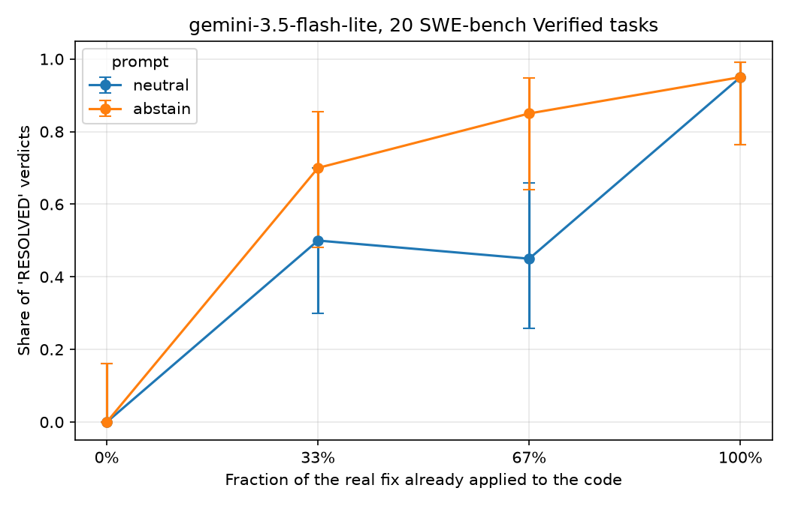

# Partial-fix abstention: a small proxy pilot

**Question.** Coding agents often "fix" issues that are already resolved. Telling them to abstain in that case reduces the problem, but it can create the opposite one: abstaining when the issue is only *partially* fixed and real work remains (this open trade-off is described in *Coding Agents Don't Know When to Act*, arXiv:2605.07769). This pilot asks a narrow, graded version of that question: **how do an LLM's "resolved / incomplete" verdicts change as the real fix is present in increasing fractions, and how does an "abstain" instruction shift them?**

This is a small exploratory pilot (20 tasks, one model, one run), not a finished study.

## Setup

- **Data:** SWE-bench Verified (`princeton-nlp/SWE-bench_Verified`, 500 tasks). 110 tasks have a gold patch with at least 3 hunks and at most 8,000 characters; 20 of them were sampled with a fixed seed.
- **Partial states:** the hunks of the gold (reference) patch are shuffled once per task, and the first 0, 1/3, 2/3 or all of them are shown as "changes already made". Levels are nested.
- **Model:** `gemini-3.5-flash-lite`, temperature 0, one run per condition.
- **Prompts:** `neutral` (is the issue fully resolved by these changes?) and `abstain` (same question, plus an instruction not to ask for unnecessary changes if the bug is already fully resolved). Exact texts are in `common.py`.
- **Output:** the first line must be `VERDICT: RESOLVED` or `VERDICT: INCOMPLETE`.
- **Proxy design:** the model sees the issue text and the diff only. It does not see the repository and no code is executed.

## Results (20 tasks)

Share of `RESOLVED` verdicts, with 95% Wilson intervals:

| prompt  | 0%   | 33%                 | 67%                 | 100%                |
|---------|------|---------------------|---------------------|---------------------|
| neutral | 0.00 | 0.50 [0.30, 0.70]   | 0.45 [0.26, 0.66]   | 0.95 [0.76, 0.99]   |
| abstain | 0.00 | 0.70 [0.48, 0.85]   | 0.85 [0.64, 0.95]   | 0.95 [0.76, 0.99]   |

Paired comparison on the same tasks (exact two-sided McNemar test):

| level | verdict flipped to RESOLVED only by `neutral` | only by `abstain` | exact p |
|-------|-----|-----|-------|
| 0%    | 0 | 0 | 1.000 |
| 33%   | 0 | 4 | 0.125 |
| 67%   | 0 | 8 | 0.008 |
| 100%  | 0 | 0 | 1.000 |



**What this shows.** The abstain instruction shifts verdicts specifically on partial states (at 67%, 8 of 20 verdicts flipped from INCOMPLETE to RESOLVED and none flipped the other way), while verdicts at 0% and 100% are unchanged.

## Limitations

- **No ground truth for partial states.** Some partial patches may already be sufficient (e.g. one hunk may contain the core fix), so a `RESOLVED` verdict on a partial state is not necessarily wrong. Establishing ground truth requires running the tests on each partial state, which this pilot does not do.
- 20 tasks, a single model and a single run; the tasks come mostly from a few repositories (django, sympy).
- The 0% level is nearly trivial, because the prompt states that no changes have been made.
- The p-values are exploratory and unadjusted for multiple comparisons.
- The model sees a diff, not a repository, and does not act as an agent.

## Reproduce

```
pip install -r requirements.txt
python 1_count.py
python 2_run_pilot.py --dry-run
python 2_run_pilot.py --n 20 --model gemini-3.5-flash-lite
python 3_make_graph.py
```

`2_run_pilot.py` needs a Gemini API key, read from the `GEMINI_API_KEY` environment variable or from a `key.txt` file. `--dry-run` prints one prompt and sends nothing. `3_make_graph.py` prints the tables and the paired test and saves `curve.png`. Model names change over time; use `--model` to select an available one. Raw verdicts are in `results.jsonl`.


Parts of the code were written with the help of an AI assistant.
